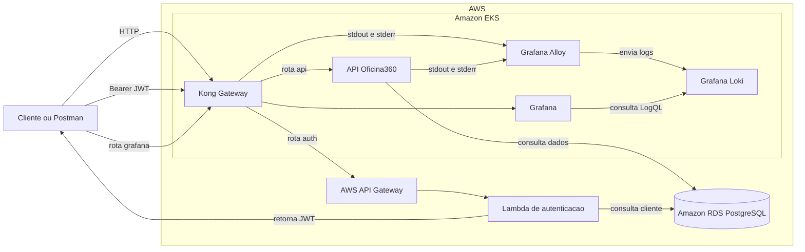
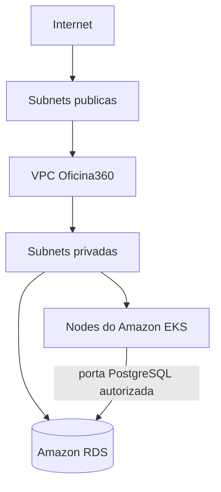
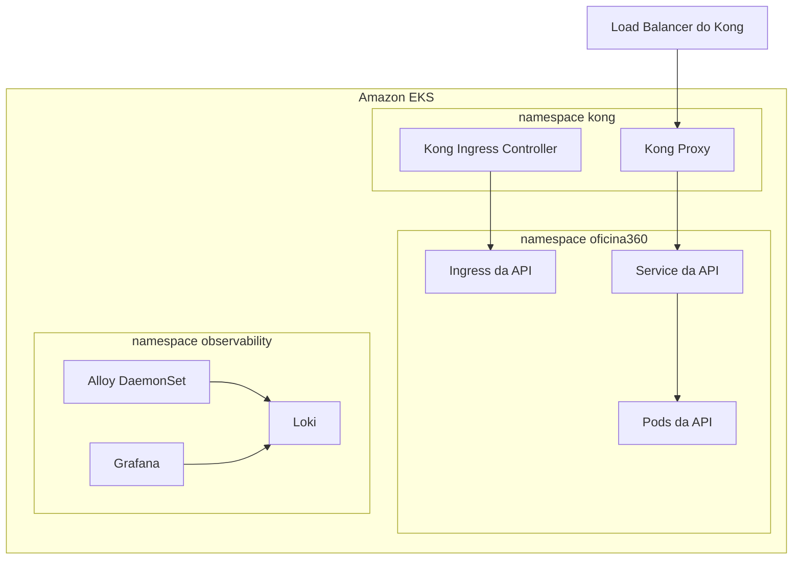
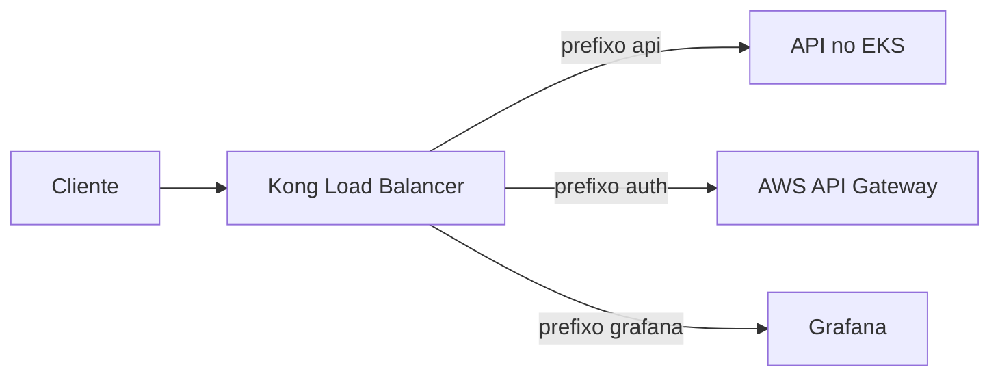
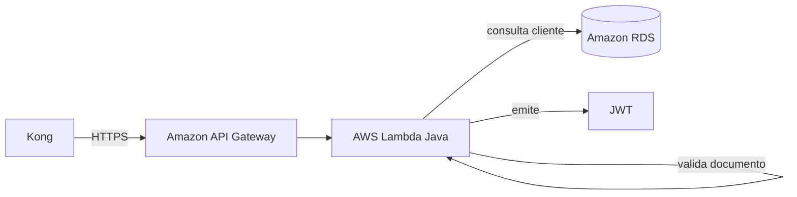
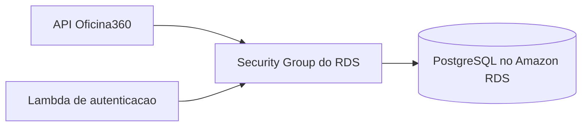
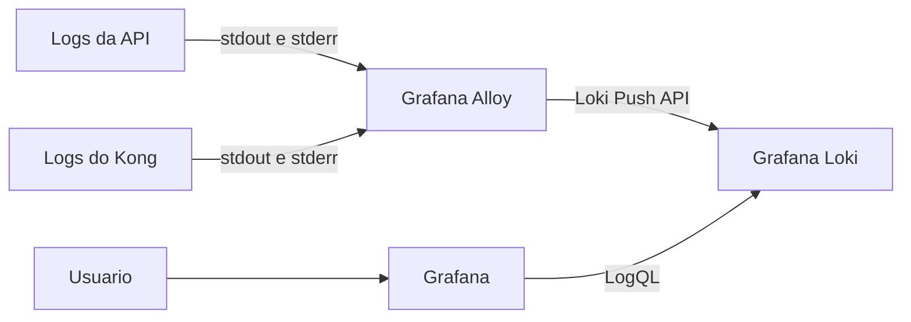
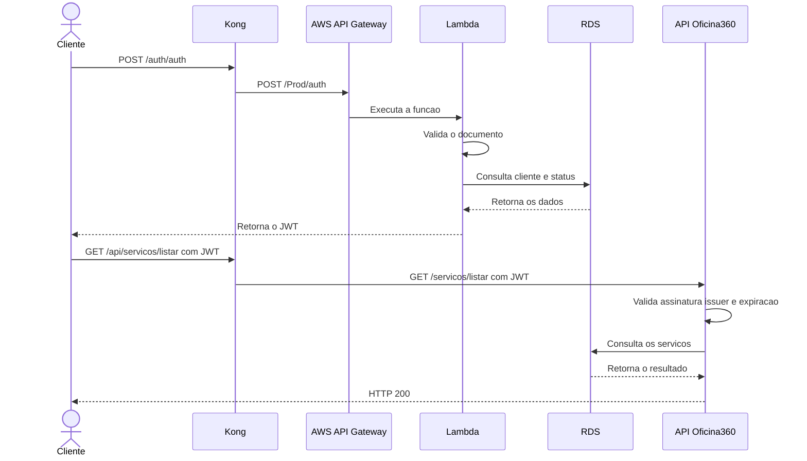
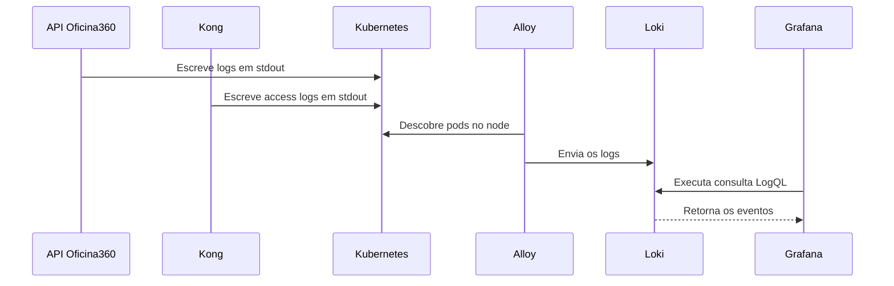
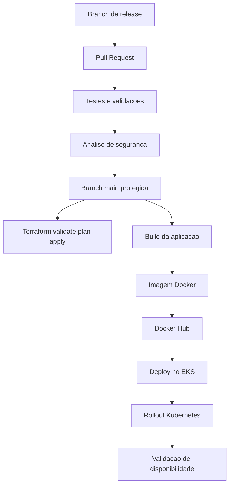

# Oficina360 - Infraestrutura AWS

Infraestrutura como código da **Oficina360**, desenvolvida para a Fase 3 do Tech Challenge.

Este repositório provisiona e opera a plataforma na AWS, incluindo rede, Amazon EKS, Amazon RDS, recursos Kubernetes, Kong Gateway e a stack de observabilidade com Grafana, Loki e Alloy.

## Sumário

- [Objetivo](#objetivo)
- [Responsabilidades deste repositório](#responsabilidades-deste-repositório)
- [Tecnologias](#tecnologias)
- [Arquitetura geral](#arquitetura-geral)
- [Arquitetura por componente](#arquitetura-por-componente)
- [Fluxo de autenticação](#fluxo-de-autenticação)
- [Fluxo de observabilidade](#fluxo-de-observabilidade)
- [Fluxo de CI/CD](#fluxo-de-cicd)
- [Rotas públicas](#rotas-públicas)
- [Estrutura do repositório](#estrutura-do-repositório)
- [Pré-requisitos](#pré-requisitos)
- [Configuração do GitHub](#configuração-do-github)
- [Validação local](#validação-local)
- [Ordem de deploy](#ordem-de-deploy)
- [Validação do ambiente](#validação-do-ambiente)
- [Acesso ao Grafana](#acesso-ao-grafana)
- [Diagnósticos](#diagnósticos)
- [Ordem de destruição](#ordem-de-destruição)
- [Segurança](#segurança)
- [Repositórios relacionados](#repositórios-relacionados)

## Objetivo

Disponibilizar uma plataforma reproduzível e automatizada para execução da Oficina360 na AWS, contemplando:

- infraestrutura provisionada com Terraform;
- aplicação executada no Amazon EKS;
- PostgreSQL gerenciado pelo Amazon RDS;
- autenticação serverless com AWS Lambda e Amazon API Gateway;
- entrada única pelo Kong Gateway;
- observabilidade centralizada com Grafana, Loki e Alloy;
- pipelines para validação, implantação, diagnóstico e destruição.

## Responsabilidades deste repositório

Este repositório é responsável por:

### Infraestrutura AWS

- Criar a VPC e os componentes de rede necessários.
- Provisionar o cluster Amazon EKS e o node group.
- Configurar Security Groups e regras de conectividade.
- Manter o estado da infraestrutura com Terraform.

### Plataforma Kubernetes

- Implantar a API Oficina360 no EKS.
- Criar Deployments, Services, Ingresses e configurações da aplicação.
- Organizar os componentes nos namespaces `oficina360`, `kong` e `observability`.
- Validar rollouts e disponibilidade dos workloads.

### API Gateway

- Instalar o Kong Gateway por Helm.
- Publicar as rotas externas `/api`, `/auth` e `/grafana`.
- Encaminhar `/api` para a aplicação no EKS.
- Encaminhar `/auth` para o Amazon API Gateway e para a Lambda.
- Publicar o Grafana pelo mesmo Load Balancer do Kong.

### Observabilidade

- Implantar Grafana, Loki e Alloy.
- Coletar logs da API e do Kong a partir de `stdout` e `stderr`.
- Armazenar os logs no Loki.
- Provisionar o datasource Loki e o dashboard da Oficina360.
- Permitir consultas LogQL e acompanhamento em tempo quase real.

### Automação

- Executar validações locais e nas pipelines.
- Automatizar deploy e destroy por GitHub Actions.
- Gerar diagnósticos sanitizados em caso de falha.
- Publicar diagnósticos como artifacts temporários.

### Fora do escopo deste repositório

- O código-fonte da API possui repositório próprio.
- A imagem da API é publicada no Docker Hub.
- A Lambda de autenticação possui repositório e pipeline próprios.

## Tecnologias

- AWS
- Amazon VPC
- Amazon EKS
- Amazon RDS for PostgreSQL
- AWS Lambda
- Amazon API Gateway
- Terraform
- Kubernetes
- Helm
- Kong Gateway
- Docker
- Grafana
- Grafana Loki
- Grafana Alloy
- GitHub Actions

## Arquitetura geral



> O diagrama utiliza rótulos sem caracteres especiais dentro dos nós para ampliar a compatibilidade com o renderizador Mermaid do GitHub.

## Arquitetura por componente

### 1. Rede AWS



A camada de rede isola os workloads e controla a comunicação entre o cluster, o banco e a internet por meio de subnets e Security Groups.

### 2. Amazon EKS



O EKS executa a aplicação, o gateway e a observabilidade em namespaces separados. O Alloy é implantado como `DaemonSet`, permitindo uma instância por node.

### 3. Kong Gateway



O Kong funciona como ponto único de entrada e aplica o roteamento por prefixo:

- `/api` direciona para a API Oficina360;
- `/auth` direciona para o endpoint externo de autenticação;
- `/grafana` direciona para o Grafana no namespace de observabilidade.

### 4. Autenticação serverless



A Lambda valida o documento, consulta a existência e o status do cliente e, quando a autenticação é válida, emite o JWT utilizado pela API.

### 5. Banco de dados



O banco PostgreSQL é gerenciado pelo Amazon RDS. A conectividade é controlada por Security Groups e as credenciais são fornecidas por Secrets.

### 6. Observabilidade



A stack atual centraliza logs. Métricas de infraestrutura como CPU, memória e utilização de nodes exigem uma fonte adicional, como Prometheus ou Grafana Mimir.

## Fluxo de autenticação



## Fluxo de observabilidade



## Fluxo de CI/CD



A branch `main` é protegida contra commits diretos. As alterações devem ser submetidas por Pull Request, com execução dos checks configurados.

## Rotas públicas

| Método | Rota pública | Destino interno | Finalidade |
|---|---|---|---|
| `POST` | `/auth/auth` | `/Prod/auth` no Amazon API Gateway | Autenticação e geração do JWT |
| `GET` | `/api/servicos/listar` | `/servicos/listar` na API | Exemplo de rota protegida |
| `GET` | `/grafana/` | Grafana no namespace `observability` | Consulta da observabilidade |

Todas as rotas utilizam como base o hostname do Load Balancer do Kong.

## Namespaces Kubernetes

| Namespace | Responsabilidade |
|---|---|
| `oficina360` | API, Services e Ingresses da aplicação |
| `kong` | Kong Gateway e Ingress Controller |
| `observability` | Grafana, Loki e Alloy |

## Estrutura do repositório

```text
.github/workflows/       workflows de validate, deploy e destroy
terraform/lab/           infraestrutura AWS provisionada com Terraform
k8s/aws/                 manifests da aplicação no EKS
k8s/kong/                values do Kong, Services e Ingresses
k8s/observabilidade/     values Helm do Grafana, Loki e Alloy
k8s/grafana/             dashboards provisionados
scripts/                 scripts de validação e diagnóstico
```

## Pré-requisitos

### Ferramentas locais

- AWS CLI
- Terraform
- kubectl
- Helm
- Bash
- jq
- envsubst

### Acesso necessário

- Conta AWS com permissões para EKS, RDS, VPC, IAM e demais recursos utilizados.
- Acesso ao repositório e ao GitHub Actions.
- Credenciais válidas configuradas como Secrets.
- Docker Hub acessível para obtenção da imagem da API.

## Configuração do GitHub

### Secrets

```text
AWS_ACCESS_KEY_ID
AWS_SECRET_ACCESS_KEY
AWS_SESSION_TOKEN
DB_USERNAME
DB_PASSWORD
JWT_SECRET
GRAFANA_ADMIN_PASSWORD
```

### Variables

```text
AWS_REGION=us-east-1
AUTH_API_HOST=<hostname do Amazon API Gateway>
```

Exemplo válido para `AUTH_API_HOST`:

```text
abc123.execute-api.us-east-1.amazonaws.com
```

O valor deve conter somente o hostname, sem `https://`, porta, stage ou caminho.

## Validação local

```bash
bash scripts/validate-platform.sh
```

A validação deve verificar, conforme o componente:

- formatação e sintaxe do Terraform;
- renderização dos charts Helm;
- validade básica dos manifestos Kubernetes;
- presença das variáveis obrigatórias;
- ausência de placeholders não substituídos;
- arquivos necessários para as pipelines.

## Ordem de deploy

1. Execute **Infrastructure Apply**.
2. Execute **Aplicacao** com a ação `deploy` e informe a imagem do Docker Hub.
3. Implante a Lambda pelo repositório próprio.
4. Execute **Kong** com a ação `deploy`.
5. Execute **Observabilidade** com a ação `deploy`.

Os workflows são manuais. Selecionar `deploy` e clicar em **Run workflow** representa a confirmação da implantação.

## Validação do ambiente

### Nodes do EKS

```bash
kubectl get nodes
```

### Aplicação

```bash
kubectl get pods,deployments,services,ingresses \
  --namespace oficina360 \
  --output wide
```

### Kong

```bash
kubectl get pods,deployments,services \
  --namespace kong \
  --output wide
```

### Observabilidade

```bash
kubectl get pods,deployments,daemonsets,services,ingresses \
  --namespace observability \
  --output wide
```

### Todos os Ingresses

```bash
kubectl get ingress --all-namespaces --output wide
```

## Descobrir a URL do Kong

```bash
KONG_HOST="$(
  kubectl get service kong-kong-proxy \
    --namespace kong \
    --output jsonpath='{.status.loadBalancer.ingress[0].hostname}'
)"

echo "Kong: http://${KONG_HOST}"
```

## Acesso ao Grafana

O Grafana utiliza o mesmo Load Balancer do Kong e é publicado no subpath `/grafana/`:

```bash
echo "Grafana: http://${KONG_HOST}/grafana/"
```

Também é possível recuperar o hostname pelo Ingress:

```bash
GRAFANA_HOST="$(
  kubectl get ingress grafana \
    --namespace observability \
    --output jsonpath='{.status.loadBalancer.ingress[0].hostname}'
)"

echo "Grafana: http://${GRAFANA_HOST}/grafana/"
```

A barra final em `/grafana/` é necessária para o subpath.

Usuário padrão:

```text
admin
```

A senha é carregada pelo Secret criado a partir de `GRAFANA_ADMIN_PASSWORD` e não deve ser documentada no repositório.

### Consultas LogQL úteis

Logs gerais da aplicação:

```logql
{namespace="oficina360"}
```

Logs gerais do Kong:

```logql
{namespace="kong"}
```

Requisições da API e da autenticação sem o ruído do endpoint de status:

```logql
{namespace="kong"}
!= "/status"
|~ "/api/|/auth"
```

Erros HTTP observados pelo Kong:

```logql
{namespace="kong"}
!= "/status"
| regexp `"(?P<method>[A-Z]+) (?P<uri>\S+) [^"]+" (?P<status>[45]\d\d)`
| line_format `ERRO HTTP {{.status}} | {{.method}} {{.uri}}`
```

## Teste funcional

### Autenticação

```bash
curl --request POST \
  "http://${KONG_HOST}/auth/auth" \
  --header 'Content-Type: application/json' \
  --data '{"document":"DOCUMENTO_DE_TESTE"}'
```

### Rota protegida

```bash
curl --request GET \
  --get "http://${KONG_HOST}/api/servicos/listar" \
  --data-urlencode 'user=admin@oficina360.com' \
  --header "Authorization: Bearer ${TOKEN}"
```

## Diagnósticos

Em caso de falha, os workflows geram arquivos `.txt` sanitizados e publicam os arquivos como artifacts.

Caminho no GitHub:

```text
Actions -> execução do workflow -> Artifacts
```

O período de retenção depende do valor `retention-days` configurado em cada workflow.

### Logs da API

```bash
kubectl logs \
  --namespace oficina360 \
  deployment/oficina360-api \
  --all-containers=true \
  --since=15m
```

### Logs do Kong

```bash
kubectl logs \
  --namespace kong \
  deployment/kong-kong \
  --all-containers=true \
  --since=15m
```

### Logs do Alloy

```bash
kubectl logs \
  --namespace observability \
  --selector app.kubernetes.io/name=alloy \
  --all-containers=true \
  --since=15m
```

## Ordem de destruição

1. Destrua a stack SAM da Lambda no repositório próprio.
2. Execute **Observabilidade** com a ação `destroy`.
3. Execute **Kong** com a ação `destroy`.
4. Execute **Aplicacao** com a ação `destroy`.
5. Execute **Infrastructure Destroy**.

A confirmação textual `DESTROY` deve ser exigida somente para a destruição total da infraestrutura.

## Segurança

- Não armazene credenciais AWS no repositório.
- Não versione kubeconfigs, arquivos `.env` ou arquivos `terraform.tfvars` sensíveis.
- Não registre CPF, JWT, senha ou header `Authorization` nos logs.
- Utilize GitHub Secrets para valores sensíveis.
- Utilize GitHub Variables para configurações não sensíveis e dinâmicas.
- Mantenha a branch `main` protegida contra commits diretos.
- Utilize Pull Requests e checks obrigatórios.
- Revogue imediatamente qualquer credencial exposta.

## Repositórios relacionados

Preencha os links antes da entrega:

```text
Lambda e autenticação: <URL>
Infraestrutura Kubernetes e AWS: <URL>
Infraestrutura do banco: <URL>
Aplicação principal: <URL>
```

## Evidências da entrega

```text
Vídeo de demonstração: <URL>
Collection do Postman: <URL ou caminho>
Documento de entrega: <URL>
```
